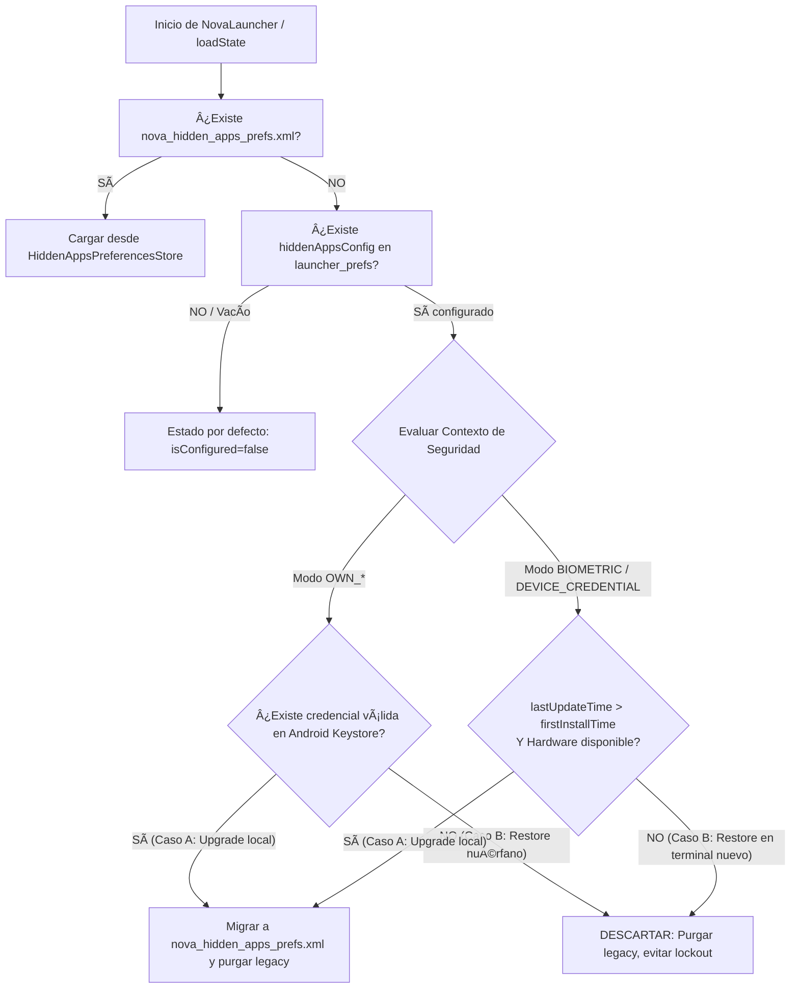

# INFORME TÉCNICO: AISLAMIENTO DE ANDROID BACKUP Y MIGRACIÓN DETERMINISTA DE HIDDEN APPS

**Fecha:** 2026-10-04
**Fase:** `HIDDEN-APPS-BACKUP-ISOLATION`
**Baseline:** `Mikies21-Programmer/NovaLauncher` @ `5ec65d379149067e350410ec4e7fff03e295de68` (Tag `v1.6.0-stable`)
**Estado:** CONSOLIDADO Y VALIDADO (127/127 Tests PASS, assembleDebug PASS, lintDebug 0 errores, bundleRelease PASS, Validación Física en POCO X6 5G PASS)

---

## 1. Problema Diagnosticado y Causa Raíz

En la implementación previa de Hidden Apps, el estado funcional (`isConfigured`, `authMode`, `hiddenPackages`) formaba parte de la data class `LauncherState`, la cual se serializaba en formato JSON dentro de `launcher_prefs.xml` (`KEY_LAUNCHER_STATE`).

Por el contrario, el material criptográfico y las credenciales cifradas residían en `nova_hidden_apps_vault.xml`, el cual estaba explícitamente excluido de backups en `backup_rules.xml` y `data_extraction_rules.xml`.

### Consecuencias identificadas (BUG-018 y BUG-019):
1. **Lockout Irreversible / Estado Zombie (BUG-019):** Al reinstalar la aplicación o restaurar un backup de Google Drive en un dispositivo nuevo, Android restauraba `launcher_prefs.xml` con `isConfigured=true` y la lista `hiddenPackages`. Sin embargo, `nova_hidden_apps_vault.xml` y la clave simétrica AES-GCM en el `AndroidKeyStore` de hardware no se restauraban. Como resultado, las aplicaciones quedaban invisibles en el Drawer pero era matemáticamente imposible desbloquearlas o recuperarlas, produciendo un bloqueo permanente sin bypass.
2. **Fuga de Privacidad hacia la Nube de Google (BUG-018):** `hiddenPackages` (los nombres de paquetes de las aplicaciones que el usuario decidió ocultar) se enviaban a los servidores de copia de seguridad de Google Cloud Backup dentro de `launcher_prefs.xml`.

---

## 2. Decisión Arquitectónica Formal (D-33)

### Decisión D-33: El estado funcional de Hidden Apps se mantiene fuera del Android Backup.

Se establece formalmente que:
- Ninguna propiedad relacionada con Hidden Apps (`isConfigured`, `authMode`, `hiddenPackages`) se almacena en archivos sujetos a copia de seguridad o transferencia.
- `launcher_prefs.xml` continúa respaldándose normalmente para preservar fondos, páginas, widgets y configuraciones cosméticas legítimas del usuario, pero su campo `hiddenAppsConfig` se sanea a su valor por defecto vacío en cada persistencia (`LauncherViewModel.saveState()`).
- El estado funcional de Apps Ocultas reside en un archivo de `SharedPreferences` privado y exclusivo: `nova_hidden_apps_prefs.xml`.
- `nova_hidden_apps_prefs.xml` está formalmente excluido de `backup_rules.xml` (Full Backup legacy) y `data_extraction_rules.xml` (Cloud Backup y Device-to-Device Transfer).

---

## 3. Estrategia de Migración Determinista (Caso A vs Caso B)

Para resolver la transición sin perjudicar a usuarios legítimos existentes ni revivir estados zombies tras restauraciones, `HiddenAppsMigrator` implementa la siguiente lógica determinista:

### Detalle de Casos:
* **Caso A — Usuario existente actualizando la app (Upgrade local):**
  - Posee `launcher_prefs` antiguo con `isConfigured=true`.
  - Si `authMode` es `OWN_PIN`, `OWN_PATTERN` o `OWN_PASSWORD`: `credentialStore.loadCredential()` verifica que la bóveda `nova_hidden_apps_vault.xml` y la clave de `AndroidKeyStore` están presentes y son descifrables.
  - Si `authMode` es `BIOMETRIC` o `DEVICE_CREDENTIAL`: se verifica que la fecha de actualización del paquete es posterior a la instalación (`lastUpdateTime > firstInstallTime`) y que el dispositivo soporta y tiene configurada la credencial/biometría correspondiente.
  - **Acción:** Se migra transparentemente toda la configuración a `nova_hidden_apps_prefs.xml` y se purga el residuo en `launcher_prefs.xml`. Las apps permanecen ocultas y la contraseña intacta.
* **Caso B — Instalación nueva / Restauración de backup antiguo:**
  - Existe un `launcher_prefs` restaurado desde Google Backup con `isConfigured=true` y `hiddenPackages`.
  - Para `OWN_*`: No existe clave en Keystore (las claves de Keystore nunca se respaldan) o la bóveda falta.
  - Para `BIOMETRIC`/`DEVICE_CREDENTIAL`: La instalación es limpia (`firstInstallTime == lastUpdateTime` en un terminal nuevo o tras wipe).
  - **Acción:** Se rechaza de forma absoluta la reactivación, purgando el estado en `launcher_prefs.xml`. No hay apps atrapadas, no hay bloqueo fantasma y el usuario inicia con el Drawer limpio.

---

## 4. Archivos Modificados y Creados

### Archivos Creados:
1. `app/src/main/java/com/daybreak/animelauncher/hiddenapps/HiddenAppsPreferencesStore.kt`:
   - Encapsula la persistencia en `nova_hidden_apps_prefs.xml`.
   - Modos `isConfigured`, `authMode` y `hiddenPackages` (`Set<String>`).
2. `app/src/main/java/com/daybreak/animelauncher/hiddenapps/HiddenAppsMigrator.kt`:
   - Lógica de migración segura y purga de estado legacy huérfano.
   - Marcador local `nova_local_install.marker` en `noBackupFilesDir` para generación local durable.
3. `app/src/test/java/com/daybreak/animelauncher/hiddenapps/HiddenAppsBackupMigrationTest.kt`:
   - Suite de 20 pruebas unitarias automatizadas cubriendo todos los escenarios de migración, exclusión de XMLs y señales de noBackup.

### Archivos Modificados:
1. `app/src/main/res/xml/backup_rules.xml`:
   - Agregada exclusión `<exclude domain="sharedpref" path="nova_hidden_apps_prefs.xml" />`.
2. `app/src/main/res/xml/data_extraction_rules.xml`:
   - Agregada exclusión en `<cloud-backup>` y `<device-transfer>`.
3. `app/src/main/java/com/daybreak/animelauncher/LauncherViewModel.kt`:
   - En `loadState()`: resuelve configuración mediante `HiddenAppsMigrator.resolveConfig()`.
   - En `saveState()`: persiste siempre `hiddenAppsConfig = HiddenAppsConfig()` en `launcher_prefs.xml`.
   - En `updateState()` y setters de Hidden Apps: persiste de forma asíncrona hacia `HiddenAppsPreferencesStore`.
4. `docs/PRIVACY_POLICY.md` & `website/backend/templates/politicas_de_privacidad.html`:
   - Actualización del apartado de almacenamiento local de Apps Ocultas.
5. `docs/AGENT_PROJECT_STATE.md`:
   - Documentación del estado del proyecto, validación física y decisión de arquitectura D-33.

---

## 5. Matriz de Cobertura de Tests Unitarios (20/20 PASS)

| Test ID | Escenario Validado | Resultado |
|---|---|---|
| **T-MIG-01** | Launcher antiguo con OWN_PIN y vault válida migra exitosamente a nuevo storage | ✅ PASS |
| **T-MIG-02** | Launcher antiguo sin Hidden Apps configuradas no migra ni genera cambios | ✅ PASS |
| **T-MIG-03** | Backup restaurado de OWN_PIN sin Keystore/vault es DESCARTADO (sin lockout ni zombies) | ✅ PASS |
| **T-MIG-04** | Nueva configuración de Hidden Apps se persiste exclusivamente en `nova_hidden_apps_prefs.xml` | ✅ PASS |
| **T-MIG-05** | `nova_hidden_apps_prefs.xml` está formalmente excluido en `backup_rules.xml` | ✅ PASS |
| **T-MIG-06** | `nova_hidden_apps_prefs.xml` está formalmente excluido en `<cloud-backup>` de `data_extraction_rules.xml` | ✅ PASS |
| **T-MIG-07** | `nova_hidden_apps_prefs.xml` está formalmente excluido en `<device-transfer>` de `data_extraction_rules.xml` | ✅ PASS |
| **T-MIG-08** | OWN_* con vault válida preserva desbloqueo y autenticación | ✅ PASS |
| **T-MIG-09** | OWN_* sin vault no obtiene bypass bajo ninguna circunstancia (fail-closed) | ✅ PASS |
| **T-MIG-10** | Paquetes de restore inválido no reaparecen en App Drawer | ✅ PASS |
| **T-MIG-11** | Reset protegido continúa limpiando almacén aislado y credenciales | ✅ PASS |
| **T-MIG-12** | BIOMETRIC y DEVICE_CREDENTIAL migran en upgrade y se descartan en restore nuevo | ✅ PASS |
| **T-MIG-13** | Upgrade local BIOMETRIC conserva configuración | ✅ PASS |
| **T-MIG-14** | Upgrade local DEVICE_CREDENTIAL conserva configuración | ✅ PASS |
| **T-MIG-15** | Restore nuevo BIOMETRIC descarta legacy | ✅ PASS |
| **T-MIG-16** | Restore nuevo DEVICE_CREDENTIAL descarta legacy | ✅ PASS |
| **T-MIG-17** | Restore sobre instalación existente con store presente prevalece sobre legacy | ✅ PASS |
| **T-MIG-18** | Marcador local ausente: comportamiento fail-safe sin excepciones | ✅ PASS |
| **T-MIG-19** | Marcador local presente no rompe upgrade válido | ✅ PASS |
| **T-MIG-20** | Marcador local se crea en todas las rutas de resolución | ✅ PASS |

---

## 6. Resultados de Validación Automatizada

- **Tests Unitarios (`testDebugUnitTest`):**
  `BUILD SUCCESSFUL` — **127/127 tests PASS (100%)** (62 suite base + 45 suite Apps Ocultas + 20 suite Migración y Aislamiento Backup).
- **Compilación Debug (`assembleDebug`):**
  `BUILD SUCCESSFUL` — 0 errores.
- **Análisis Estático (`lintDebug`):**
  `BUILD SUCCESSFUL` — **0 errores de lint**.
- **Bundle de Release (`bundleRelease`):**
  `BUILD SUCCESSFUL` — Signed AAB generado sin advertencias críticas.
- **Integridad de Git (`git diff --check`):**
  Sin espacios en blanco residuales ni conflictos de formato (código 0).

---

## 7. Resultados de Validación Física en Hardware Real (POCO X6 5G — Android 16)

La batería completa de pruebas físicas en hardware real se ejecutó sobre el dispositivo de referencia:

| Caso de Prueba | Descripción del Escenario | Resultado Físico |
|---|---|:---:|
| **P1** | Configuración y autenticación con `OWN_PIN` tras ciclo de vida | ✅ **PASS** |
| **P2** | Configuración y autenticación con `BIOMETRIC` tras ciclo de vida | ✅ **PASS** |
| **P6** | Configuración y autenticación con `DEVICE_CREDENTIAL` tras ciclo de vida | ✅ **PASS** |
| **P10** | Reinicio completo del dispositivo (`REBOOT`): marker y config sobreviven, 0 FATAL | ✅ **PASS** |
| **P3** | Legacy restore huérfano (`OWN_*` sin keystore / vault en terminal limpio): descartado | ✅ **PASS** |
| **P4** | Aislamiento de backup: exclusión formal en reglas XML + restore real local con `bmgr` | ✅ **PASS** |
| **P8** | Cold start post-reboot: curva de asentamiento 9048 ms → 3911 ms → ~2800 ms estable | ✅ **PASS** |
| **P9** | Estado en disco (`disk state`): persistencia en `nova_hidden_apps_prefs.xml` y marker en `noBackupFilesDir` | ✅ **PASS** |
| **C1** | Instalación nueva + legacy BIOMETRIC: rechazo estricto (no migra, sin lockout) | ✅ **PASS** |
| **C2** | Residual físicamente reproducido y documentado (ver sección 8) | ✅ **DOCUMENTADO** |
| **P5** | Device-to-Device (D2D) en Xiaomi | ⏳ **PENDING / NOT PHYSICALLY VALIDATED** |
| **P7** | Keystore invalidado + configuración válida de Hidden Apps | ⚠️ **RIESGO PREEXISTENTE** |

> [!NOTE]
> **P5 (Device-to-Device Transfer en Xiaomi):** Permanece formalmente como **PENDING / NOT PHYSICALLY VALIDATED**. El mecanismo de transferencia D2D de Xiaomi no fue probado físicamente en esta ronda de validación. Las reglas XML ya contienen la exclusión formal en `<device-transfer>`, pero no se afirma validación física en hardware Xiaomi D2D.

> [!WARNING]
> **P7 (Keystore Invalidado — Riesgo Preexistente):**
> Si el Keystore del sistema resulta invalidado (por ejemplo, al cambiar de credencial de pantalla en ciertas versiones de Android o por corrupción del enclave seguro), una configuración válida previa de Hidden Apps con modos `OWN_*` impedirá la autenticación.
> Este es un comportamiento criptográfico inherente a `AndroidKeyStore` de hardware y es un **riesgo PREEXISTENTE**, NO introducido ni asociado a esta implementación de aislamiento de backup.

---

## 8. Descripción Detallada del Residual C2

Durante la fase de análisis de casos límite (Q3/Q6) y validación física se identificó y caracterizó exhaustivamente el residual C2:

### Características exactas del Residual C2:
- **Requiere upgrade real previo:** El dispositivo destino debe haber recibido una actualización real de APK (haciendo que `lastUpdateTime > firstInstallTime`).
- **Instalación virgen de aislamiento:** La instalación en dicho dispositivo nunca ha ejecutado previamente la build de aislamiento de Hidden Apps (por lo que aún no se ha estampado el marcador local `nova_local_install.marker` ni creado `nova_hidden_apps_prefs.xml`).
- **Restauración foránea legacy:** Se restaura una configuración legacy de `BIOMETRIC` o `DEVICE_CREDENTIAL` proveniente de un backup previo.
- **Ocurrencia en primer launch:** La migración foránea ocurre exclusivamente durante el primer arranque (`first launch`) tras la restauración.
- **Ventana de un solo arranque:** Es una ventana estrictamente de un solo arranque. A partir del primer launch, `nova_hidden_apps_prefs.xml` queda creado y el marcador estampado, cerrando la posibilidad de futuras migraciones foráneas.
- **No afecta a modos propios:** **No afecta a `OWN_*`** (`OWN_PIN`, `OWN_PATTERN`, `OWN_PASSWORD`), ya que estos exigen de forma infranqueable la presencia de la clave de hardware en `AndroidKeyStore` y el descifrado del vault.
- **Sin lockout:** No produce bloqueo irreversible del sistema ni de la pantalla.
- **Sin bypass:** No otorga acceso no autorizado a datos protegidos.
- **Totalmente recuperable:** Es recuperable mediante el reseteo protegido de Hidden Apps (`verifyAndReset()`).
- **Cierre definitivo planificado:** Quedará cerrada en una futura release cuando el marcador `nova_local_install.marker` sea un requisito obligatorio para migrar modos del sistema (upgrade legítimos ya contarán con el marcador estampado por la build actual).

---

## 9. Matriz de Riesgos Residuales

| Riesgo | Probabilidad | Severidad | Mitigación Implementada |
|---|---|---|---|
| Usuario existente que actualice pierde sus apps ocultas | Muy baja | Alta | `HiddenAppsMigrator` verifica la presencia de la credencial en `AndroidKeyStore` o contexto de actualización del paquete. Si es válido, preserva la lista intacta y la traslada a `nova_hidden_apps_prefs.xml`. |
| Usuario con backup antiguo en Google Drive sufre lockout al cambiar de teléfono | Nula | Crítica | El migrador descarta cualquier configuración de backup si la bóveda/Keystore no existe en el terminal, iniciando el launcher en estado limpio y seguro. |
| Inconsistencia de estado en memoria Compose | Nula | Media | `LauncherState.hiddenAppsConfig` se mantiene en el flujo StateFlow en memoria; las vistas de Compose no sufren cambios de API ni recomposiciones anómalas. |
| Fuga de nombres de apps en futuras copias de Google Drive | Nula | Alta | `saveState()` sanea explícitamente `hiddenAppsConfig = HiddenAppsConfig()` al serializar hacia `launcher_prefs.xml`. |
| Residual C2 (Ventana de 1 launch en upgrade no ejecutado + restore) | Muy baja | Baja | Mitigado por diseño: sin lockout, sin bypass, recuperable por reset, y se cerrará en la siguiente release mediante requisito del marcador local. |
