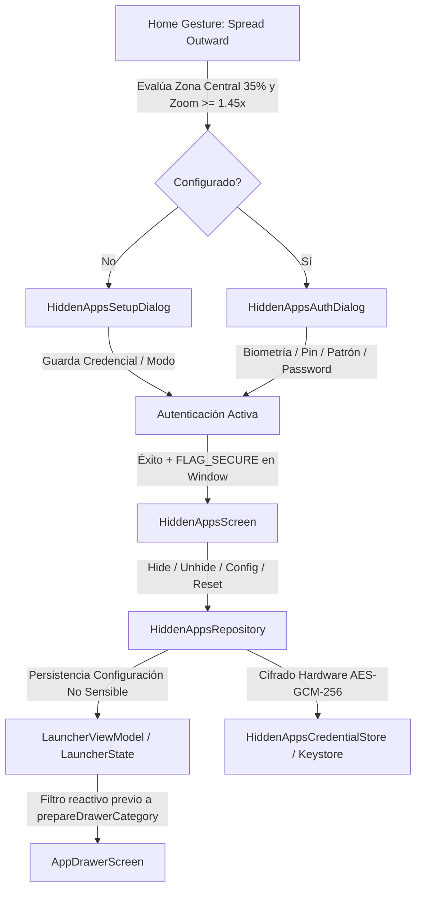

# NovaLauncher — Documentación Técnica de Implementación: Apps Ocultas (HIDDEN-APPS-IMPLEMENTATION-01)

## 1. Arquitectura General

La funcionalidad de "Apps Ocultas" implementada en NovaLauncher proporciona una bóveda privada protegida criptográficamente para ocultar aplicaciones seleccionadas del App Drawer, el rail A-Z, las categorías y los resultados de búsqueda, sin eliminarlas del sistema Android ni romper shortcuts ya fijados en las pantallas de inicio (`ViewOne` / `ViewTwo`).

### Diagrama de Flujo y Componentes



---

## 2. Archivos Modificados

| Archivo | Motivo y Alcance Quirúrgico |
|---|---|
| `gradle/libs.versions.toml` | Declaración de la biblioteca oficial estable `androidx.biometric:biometric:1.1.0`. |
| `app/build.gradle.kts` | Inclusión de la dependencia `libs.androidx.biometric`. Preservación estricta de `versionCode = 8` y `versionName = "1.6"`. |
| `app/src/main/AndroidManifest.xml` | Declaración del permiso `android.permission.USE_BIOMETRIC`. |
| `app/src/main/java/com/daybreak/animelauncher/MainActivity.kt` | Transición de herencia a `FragmentActivity` requerida por `androidx.biometric.BiometricPrompt`. |
| `app/src/main/res/xml/backup_rules.xml` | Exclusión de `nova_hidden_apps_vault.xml` del backup en la nube de Android. |
| `app/src/main/res/xml/data_extraction_rules.xml` | Exclusión de `nova_hidden_apps_vault.xml` de transferencias de dispositivo a dispositivo. |
| `app/src/main/res/values/strings.xml` | Adición de strings localizadas completas en Español. |
| `app/src/main/res/values-en/strings.xml` | Adición de strings localizadas completas en Inglés. |
| `app/src/main/java/com/daybreak/animelauncher/LauncherViewModel.kt` | Inclusión aditiva de `hiddenAppsConfig: HiddenAppsConfig` en `LauncherState` y métodos reactivos del repositorio. |
| `app/src/main/java/com/daybreak/animelauncher/ui/screens/AppDrawerScreen.kt` | Inserción del filtro `hiddenPackages` inmediatamente antes de `prepareDrawerCategory(appsInCat)`. Preservación 100% íntegra de `CRASH-FIX-01`. |
| `app/src/main/java/com/daybreak/animelauncher/ui/screens/LauncherScreen.kt` | Detección del gesto spread outward desde páginas Home, gestión de estado de sesión efímero y presentación modal protegida. |
| `docs/PRIVACY_POLICY.md` | Documentación de procesamiento local de Hidden Apps, Keystore y delegación biométrica. |
| `website/backend/templates/politicas_de_privacidad.html` | Sincronización web de la política de privacidad local. |

---

## 3. Archivos Creados

### Lógica de Dominio y Seguridad (`com.daybreak.animelauncher.hiddenapps`)
- [`HiddenAppsModels.kt`](file:///c:/Users/migue/AndroidStudioProjects/AnimeLauncher/app/src/main/java/com/daybreak/animelauncher/hiddenapps/HiddenAppsModels.kt): Enumeraciones de modo de autenticación (`NONE`, `BIOMETRIC`, `DEVICE_CREDENTIAL`, `OWN_PIN`, `OWN_PATTERN`, `OWN_PASSWORD`), estados de flujo de UI, modelos inmutables de configuración y registro de credencial.
- [`HiddenAppsCrypto.kt`](file:///c:/Users/migue/AndroidStudioProjects/AnimeLauncher/app/src/main/java/com/daybreak/animelauncher/hiddenapps/HiddenAppsCrypto.kt): Derivación de clave mediante PBKDF2WithHmacSHA256 con salt criptográfico de 16 bytes (`SecureRandom`), 120,000 iteraciones, comparación en tiempo constante (`MessageDigest.isEqual`), validadores estrictos y funciones seguras de sanitización en memoria (`wipe`).
- [`HiddenAppsCredentialStore.kt`](file:///c:/Users/migue/AndroidStudioProjects/AnimeLauncher/app/src/main/java/com/daybreak/animelauncher/hiddenapps/HiddenAppsCredentialStore.kt): Almacenamiento seguro utilizando Android Keystore con clave simétrica AES-GCM (256 bits, `NoPadding`) y persistencia del ciphertext e IV en un archivo SharedPreferences exclusivo (`nova_hidden_apps_vault.xml`).
- [`HiddenAppsAuthenticator.kt`](file:///c:/Users/migue/AndroidStudioProjects/AnimeLauncher/app/src/main/java/com/daybreak/animelauncher/hiddenapps/HiddenAppsAuthenticator.kt): Coordinador de verificación, conteo de intentos fallidos, activación de cooldown de 30 segundos tras 5 fallos consecutivos y comprobación de disponibilidad biométrica/Keyguard.
- [`HiddenAppsRepository.kt`](file:///c:/Users/migue/AndroidStudioProjects/AnimeLauncher/app/src/main/java/com/daybreak/animelauncher/hiddenapps/HiddenAppsRepository.kt): Repositorio central que coordina la persistencia del estado no sensible en `LauncherState` y el material criptográfico en `HiddenAppsCredentialStore`, con poda automática de paquetes desinstalados y regla de exclusión del propio launcher.

### Componentes de UI (`com.daybreak.animelauncher.ui.screens.hiddenapps`)
- [`HiddenAppsGesture.kt`](file:///c:/Users/migue/AndroidStudioProjects/AnimeLauncher/app/src/main/java/com/daybreak/animelauncher/ui/screens/hiddenapps/HiddenAppsGesture.kt): Detector multitáctil de dos dedos con evaluación de zona central (35%), umbral de separación de zoom 1.45x, one-shot trigger y exclusión de widgets/modos no válidos.
- [`PatternLockView.kt`](file:///c:/Users/migue/AndroidStudioProjects/AnimeLauncher/app/src/main/java/com/daybreak/animelauncher/ui/screens/hiddenapps/PatternLockView.kt): Componente Canvas interactivo en Jetpack Compose para entrada de patrones 3x3.
- [`HiddenAppsAuthDialog.kt`](file:///c:/Users/migue/AndroidStudioProjects/AnimeLauncher/app/src/main/java/com/daybreak/animelauncher/ui/screens/hiddenapps/HiddenAppsAuthDialog.kt): Modal de autenticación con soporte para biometría, PIN, patrón, contraseña, contador de cooldown y flujo de restablecimiento destructivo.
- [`HiddenAppsSetupDialog.kt`](file:///c:/Users/migue/AndroidStudioProjects/AnimeLauncher/app/src/main/java/com/daybreak/animelauncher/ui/screens/hiddenapps/HiddenAppsSetupDialog.kt): Asistente de configuración y cambio de método con validación en dos pasos (entrada y confirmación).
- [`HiddenAppsScreen.kt`](file:///c:/Users/migue/AndroidStudioProjects/AnimeLauncher/app/src/main/java/com/daybreak/animelauncher/ui/screens/hiddenapps/HiddenAppsScreen.kt): Pantalla protegida de administración con `FLAG_SECURE` en la Window, buscador integrado, filtrado por pestañas y toggles inmediatos de visibilidad.

### Suite de Pruebas Unitarias (`app/src/test/java/com/daybreak/animelauncher/hiddenapps`)
- [`HiddenAppsGestureLogicTest.kt`](file:///c:/Users/migue/AndroidStudioProjects/AnimeLauncher/app/src/test/java/com/daybreak/animelauncher/hiddenapps/HiddenAppsGestureLogicTest.kt): 12 tests para la lógica pura del gesto de spread.
- [`HiddenAppsAuthTest.kt`](file:///c:/Users/migue/AndroidStudioProjects/AnimeLauncher/app/src/test/java/com/daybreak/animelauncher/hiddenapps/HiddenAppsAuthTest.kt): 9 tests para PBKDF2, validaciones, cooldown y reseteo.
- [`HiddenAppsRepositoryTest.kt`](file:///c:/Users/migue/AndroidStudioProjects/AnimeLauncher/app/src/test/java/com/daybreak/animelauncher/hiddenapps/HiddenAppsRepositoryTest.kt): 7 tests para ocultar/desocultar, regla de autoexclusión y poda.
- [`HiddenAppsDrawerIntegrationTest.kt`](file:///c:/Users/migue/AndroidStudioProjects/AnimeLauncher/app/src/test/java/com/daybreak/animelauncher/hiddenapps/HiddenAppsDrawerIntegrationTest.kt): 5 tests de integración con Drawer, categorías, búsqueda y CRASH-FIX-01.
- [`HiddenAppsLifecycleTest.kt`](file:///c:/Users/migue/AndroidStudioProjects/AnimeLauncher/app/src/test/java/com/daybreak/animelauncher/hiddenapps/HiddenAppsLifecycleTest.kt): 3 tests de ciclo de vida y estado efímero.

---

## 4. Mecanismo de Autenticación y Modos

NovaLauncher admite exactamente un método activo de protección a la vez:
1. `BIOMETRIC`: Utiliza `BiometricPrompt` con `BiometricManager.Authenticators.BIOMETRIC_STRONG`. La aplicación solo recibe el callback de éxito/error y nunca accede a datos biométricos.
2. `DEVICE_CREDENTIAL`: Utiliza las credenciales de bloqueo de pantalla del dispositivo Android (PIN, patrón o contraseña del sistema) vía `BiometricPrompt` (API 30+) o `KeyguardManager.createConfirmDeviceCredentialIntent` (API 24-29).
3. `OWN_PIN`: PIN numérico de 6 a 12 dígitos derivado con PBKDF2.
4. `OWN_PATTERN`: Patrón en cuadrícula 3x3 de mínimo 4 y máximo 9 puntos, serializado deterministamente y hasheado con PBKDF2.
5. `OWN_PASSWORD`: Contraseña alfanumérica/texto de 8 a 64 caracteres Unicode derivada con PBKDF2.

### Protocolo de Restablecimiento Protegido (Eliminación de Bypass)
El flujo de reseteo elimina categóricamente cualquier camino de bypass no autenticado:
- **Dispositivos con bloqueo seguro (`isDeviceSecure == true`):** El reseteo puede autorizarse mediante la credencial del sistema operativo (pantalla de bloqueo Android) o mediante la credencial propia de NovaLauncher.
- **Dispositivos sin bloqueo seguro (`isDeviceSecure == false`):** Se bloquea taxativamente el reseteo automático. El usuario debe ingresar obligatoriamente la credencial Nova configurada (`OWN_PIN`, `OWN_PATTERN` o `OWN_PASSWORD`), la cual se verifica formalmente con `HiddenAppsRepository.verifyAndReset()` antes de borrar credenciales o desocultar aplicaciones.
- **Reseteo cancelado:** Si el usuario cancela el diálogo o falla la verificación, no se altera ningún estado ni se borra ninguna app oculta.

---

## 5. Flujo del Gesto (Spread Outward)

El gesto se implementa con las siguientes especificaciones:
- **Ámbito:** Cualquier página Home (`Screen 1`, `Screen 2`, etc.) cuando `currentNavState == LauncherNavState.Home`.
- **Inhibidores:** Modos de edición de widgets (`currentWidgetEditMode != null`), overlays activos (`pendingThemeProposalUri != null`), desbloqueo pendiente (`isUnlockPending`) o cuando los punteros inician sobre áreas de widgets excluidas.
- **Zona Central:** El punto medio geométrico entre ambos dedos en el momento inicial debe caer dentro del 35% central de la pantalla (`CENTER_ZONE_FACTOR = 0.35f`).
- **Distancia y Zoom:** Distancia mínima inicial escalada según densidad de pantalla (`MIN_INITIAL_DISTANCE_DP = 24f`, convertida a píxeles vía `getMinInitialDistancePx(density)`). El disparo se produce cuando `currentDistance / initialDistance >= 1.45f` (`SPREAD_TRIGGER_ZOOM = 1.45f`).
- **Exclusión Mutua con Pinch-In:** Si los punteros realizan un gesto hacia adentro (`ratio < 0.85f`), el detector de Spread se cancela inmediatamente. Asimismo, si los punteros ya fueron consumidos por otro detector (como el Pinch-in de Settings), Spread descarta el evento. A su vez, `LauncherScreen.kt` inhabilita el Pinch-in mientras Apps Ocultas esté activo (`hiddenAppsFlowState == Closed`).
- **One-Shot:** Disparo único que consume los eventos del puntero y previene conflictos con la navegación horizontal o vertical.

---

## 6. Persistencia y Protección de Secretos

- **Separación de Responsabilidades:**
  - El estado no confidencial (`isConfigured`, `authMode`, `hiddenPackages`) reside en `LauncherState` persistido en `launcher_prefs.xml` vía `LauncherViewModel`.
  - El registro criptográfico (`salt`, `hash`, `iterations`, `authMode`) reside en un SharedPreferences aislado (`nova_hidden_apps_vault.xml`) cifrado en reposo con una clave de 256 bits generada en Android Keystore (`AndroidKeyStore`).
- **Sin Almacenamiento en Claro:** Ninguna contraseña, PIN o patrón se guarda en texto plano ni se envía a logs. Los búferes de caracteres temporales se sobreescriben en memoria con ceros (`HiddenAppsCrypto.wipe`) tras su uso.
- **Sin Librerías Obsoletas:** No se utiliza `androidx.security:security-crypto` ni `EncryptedSharedPreferences` / `MasterKey`. Se interactúa directamente con `KeyStore` y `Cipher.getInstance("AES/GCM/NoPadding")`.

---

## 7. Integración con App Drawer y Preservación de CRASH-FIX-01

En `AppDrawerScreen.kt`, el filtrado de paquetes ocultos se ejecuta quirúrgicamente sobre la lista de aplicaciones por categoría antes de invocar la preparación del drawer:

```kotlin
val appsInCat = installedApps
    .filter { it.category == cat }
    .filter { it.packageName !in hiddenPackages }

val prepared = prepareDrawerCategory(appsInCat)
```

**Garantías:**
- Las apps ocultas nunca ingresan a `PreparedDrawerSection.apps`.
- Desaparecen automáticamente del App Drawer principal, de las categorías, del rail A-Z y del buscador sin tocar `filterDrawerData()` ni el algoritmo de scroll.
- `CRASH-FIX-01` (`listState.firstVisibleItemIndex.coerceIn(...)`, `derivedStateOf`, guardas de categorías vacías) se mantiene 100% intacto y operativo ante listas vacías o transiciones rápidas.

---

## 8. Ciclo de Vida, Inactividad y Seguridad en Memoria

- **Estado Efímero (Fail-Closed):** La bandera `isAuthenticated` se gestiona en memoria pura (sin `rememberSaveable`). Cualquier evento de `Back`, botón Home, navegación externa o `ON_STOP` de la Activity descarta inmediatamente la sesión. Se documenta formalmente en código que la ausencia de `rememberSaveable` es una decisión de seguridad deliberada.
- **Temporizador de Auto-Cierre (60 segundos):** En `HiddenAppsScreen` autenticada, un `LaunchedEffect` monitorea la inactividad del usuario. Si transcurren 60 segundos sin interacción, la pantalla se cierra y la sesión se invalida automáticamente. Cualquier toque táctil capturado mediante `pointerInput` en `PointerEventPass.Initial` refresca la marca de tiempo de interacción.
- **FLAG_SECURE Integral:** Se aplica tanto mediante `DialogProperties(securePolicy = SecureFlagPolicy.SecureOn)` como a nivel de la Activity Window mediante `DisposableEffect` en `HiddenAppsSetupDialog`, `HiddenAppsAuthDialog` y `HiddenAppsScreen`, bloqueando capturas de pantalla, grabaciones de video y previsualizaciones en multitarea durante toda la manipulación de credenciales.
- **Sincronización de Idioma Interno:** Los diálogos y pantalla se envuelven en `CompositionLocalProvider(LocalContext, LocalConfiguration)` configurado con `Locale.forLanguageTag(state.language)`, garantizando que respeten inmediatamente el idioma configurado en NovaLauncher independientemente del locale del sistema operativo.

---

## 9. Backup y Políticas de Datos

En `backup_rules.xml` y `data_extraction_rules.xml`, se excluyó explícitamente:
```xml
<exclude domain="sharedpref" path="nova_hidden_apps_vault.xml" />
```
Esto garantiza que claves vinculadas al hardware Keystore no se exporten ni corrompan la instalación al restaurar copias de seguridad en otros dispositivos. Si un estado de `LauncherState` se restaura sin la bóveda criptográfica, el sistema adopta una postura fail-closed (no permite autenticación espuria ni desoculta paquetes sin autorización).

---

## 10. Pruebas y Validación Automatizada

- **Tests Unitarios:** 107 de 107 pruebas exitosas (62 de la suite base original + 45 pruebas unitarias de Apps Ocultas).
- **Cobertura de Seguridad Obligatoria:** Verificado en `HiddenAppsAuthTest` que sin bloqueo seguro no hay reset libre, que un reset cancelado o con credencial errónea no altera datos, y que estados restaurados sin vault no desbloquean la bóveda.
- **Compilación Debug:** `assembleDebug` exitoso.
- **Análisis Estático:** `lintDebug` y `lintVitalRelease` finalizados con cero errores.
- **Bundle de Producción:** `bundleRelease` firmado y generado exitosamente (`app-release.aab`).

---

## 11. Limitaciones Conocidas y Pendientes para Validación Física

1. **Hardware Real (POCO X6 5G):** La respuesta táctil a la velocidad del gesto de separación de dos dedos con diferentes resoluciones de pantalla y densidades DPI debe verificarse en el dispositivo físico.
2. **Sensor Biométrico Físico:** Verificación de la velocidad de invocación y desbloqueo mediante sensor de huella en pantalla del POCO X6.
3. **Comportamiento con Teclado Virtual del Sistema:** Validación visual de la elevación de campos de contraseña en resoluciones con navegación por gestos activa.
